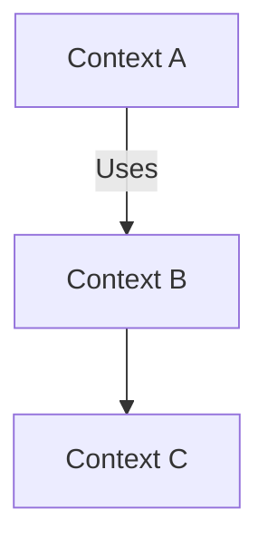

# Systems & Relations

## Bounded Contexts
- Context A — purpose, owners, SSoT(s)
- Context B — purpose, owners, SSoT(s)

## Relations (Mermaid sketch)

Sources of Truth Matrix

Area	SSoT path(s)	Notes
…	…	…
