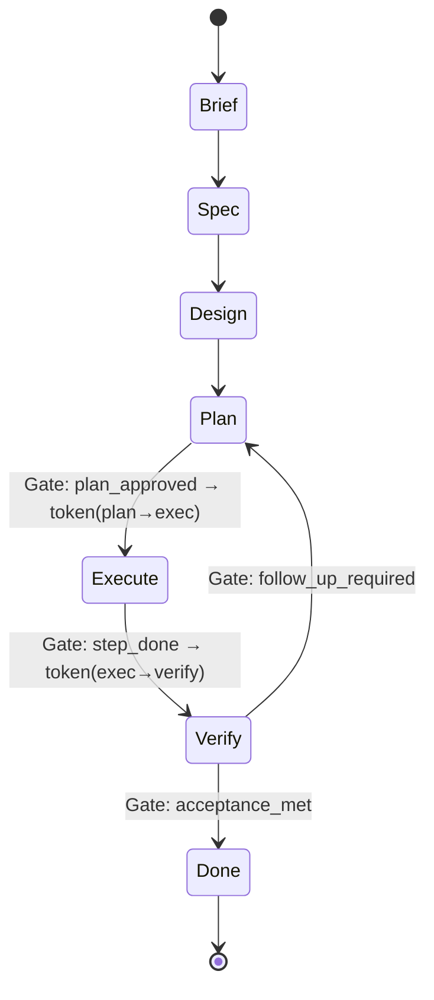

# The Canon — Operating Doctrine for Safe Speed

Version: 1.0  
Status: Living (normative)  
Owner (DRI): Canon Steward (rotating)  
North Star: Make speed safe.  
Truth Metric: Effectiveness (value/time at acceptable risk)  
Path: docs/canon/00_CANON.md

This canon is tool-agnostic. It defines the principles, shapes, and rules that all projects and products must obey. Runtimes (local engine, Temporal, …), user interfaces (CLI, IDE, mobile), and storage choices are pluggable.

---

## 0) Why this exists

- AI can create output faster than humans can review. Unchecked speed raises entropy and risk.
- The way to scale safely is to constrain freedom to the right places—codify invariants, standardize shapes, and run everything through explicit gates with observable evidence.
- This canon supplies the shared language and operating model so multiple teams and agents independently arrive at compatible designs and predictable execution.

---

## 1) Normative language

This document uses RFC keywords:
- MUST / MUST NOT — hard invariant.
- SHOULD / SHOULD NOT — strong guidance; deviations require written rationale.
- MAY — optional.

---

## 2) Core principles

1. Atomicity over ambition. Work is decomposed into the smallest verifiable units (atoms).
2. Contracts before code. Shapes and acceptance criteria precede implementation.
3. Gated flow. Progress only occurs by passing gates that mint step tokens for the next allowed actions.
4. Projection, not duplication. Human views (dashboards, vaults) are projections of canonical artifacts, never sources of truth.
5. Observability is a first‑class feature. Every action emits structured events that can be traced, analyzed, and audited.
6. Separation of concerns. Platform enforces safety & execution; products define domain semantics; promotion moves generic learnings up.
7. Emergence via evidence. Automation rises along a ladder (Human → Human‑AI → AI → Code) only when data justifies it.

---

## 3) Canonical model (shapes)

These are abstract types. Implementations must provide equivalent behavior and fields.

### 3.1 Artifact

A versioned, immutable file or record with a known schema.  
Examples: plan.md, job.yml, diagram.mmd, test fixture.

Fields (minimal):  
id, kind, version, schema_ref, created_at, source, hash.

### 3.2 Package

A folder‑like container that travels through stages and accrues artifacts.  
Invariants: contains metadata (see §6) and a golden raw source if derived from external inputs.

Fields:  
package_id, stage, domain, scope, index{path→desc}, log[].

### 3.3 Flow

A directed acyclic graph of steps with gates. Each step consumes/produces artifacts and emits events.

Step: (inputs, op, outputs, acceptance)  
Gate: predicate over evidence that, if true, mints a step token for the next step.

### 3.4 Step Token

A capability‑bearing proof issued by a gate to authorize exactly the operations permitted in the next step.

Claims (minimal):  
token_id, effort_id, flow_id, step_id, domain, scope, capabilities[], resources[], ttl, nonce, issued_at, issuer, signature (format‑agnostic).

MUST: Every write or external call during execution present a valid step token; events MUST include token_id.

### 3.5 Event

A structured, append‑only observation. All engines, agents, and humans emit events.

Core fields:  
ts, effort_id, actor { type, id }, flow_id, step_id, token_id, stage, op, status, dur_ms?, inputs_ref?, outputs_ref?, evidence?, error?, labels{}.

See §7 for the event model and chain‑of‑custody.

### 3.6 Domain

A bounded context with its own schema, inbox/outbox, processed store, and indices.  
Examples: planning, jobs, achievements, outreach, docs.

### 3.7 Projection

A read‑optimized view (e.g., Obsidian vault, dashboard) derived from packages.  
MUST NOT be edited without gatekeeping; MUST be reconciled back via structured packages if edits occur.

---

## 4) The AEF lifecycle (methodology)

The Atomic Execution Framework (AEF) is the default lifecycle. Implementations MAY extend, but MUST not weaken gates.

Phase 0 – Foundation (Governance)  
Codify product, system, and development governance.

Phase 1 – Initiation (Brief)  
Define purpose/scope/strategic alignment → brief.md.

Phase 2 – Scoping (Product Spec)  
Roadmap and atomic work items → product_spec.md.

Phase 3 – Design (Tech Spec)  
Architecture and data models → tech_spec.md.

Phase 4 – Planning (Implementation Plan)  
Stepwise, atomic instructions + acceptance → plan.md.

Phase 5 – Execution  
Run the plan via tokens; no step runs without a valid token.

Phase 6 – Verification  
Check outputs vs acceptance; failures produce follow‑up plans.

Continuous – Learning  
Bubble‑up analysis updates governance; promotions from product → platform happen here.

State machine (informative Mermaid):



---

## 5) Invariants (MUST)

1. Single source of truth: The package is canonical; projections are downstream.
2. Golden copy: If inputs come from outside, preserve an exact raw source.
3. Gated mutation: Any mutation requires a valid step token; tokens are least‑privilege and short‑lived.
4. Idempotence: Steps MUST be idempotent or provide conflict strategies; retries MUST not corrupt state.
5. Append‑only evidence: Events/logs are append‑only; corrections appear as new events, not rewrites.
6. Deterministic acceptance: Each step defines machine‑checkable acceptance.
7. Separation of concerns: Platform enforces gates & events; products own domain semantics; promotion path exists.
8. Projection discipline: Manual edits to projections MUST be re‑ingested through gatekeeping.
9. Reproducibility: A flow + inputs MUST reproduce identical outputs (within declared nondeterminism bounds).
10. Security by construction: Tokens & scopes constrain what can be read/written per step.

---

## 6) Canonical package metadata (normative shape)

Implementation formats MAY vary (e.g., YAML/JSON), but fields and semantics MUST be preserved.

```yaml
package_id: "J-20250914-134501-ab12cd"
domain: "jobs"                # or "planning", "achievements", etc.
stage: "domain.outbox"        # main.inbox | main.outbox | <domain>.inbox | <domain>.outbox | processed
scope:
  effort_id: "E-2025-09-14-01"
  bounds:
    read: ["domains/jobs/**"]
    write: ["domains/jobs/outbox/**"]
metadata:
  created_at: "2025-09-14T13:45:01Z"
  extracted_at: "2025-09-14T13:45:07Z"
  source: { origin: "paste|upload|vault|api", ref: "…" }
  keywords: ["platform", "devex", "ai"]
  tags: ["lead", "remote"]
  files:
    - { path: "raw.md", desc: "verbatim input (golden copy)" }
    - { path: "job.yml", desc: "structured schema (domain outbox)" }
    - { path: "job_card.md", desc: "human card (projection source)" }
  log:
    - { ts: "2025-09-14T13:45:05Z", actor: {type:"system",id:"normalize.v1"}, action: "normalize", token_id: "tkn-…" }
    - { ts: "2025-09-14T13:45:18Z", actor: {type:"ai",id:"gpt"}, action: "extract.job", token_id: "tkn-…" }
workflow_spec:
  ref: "flows/jobs_etl.v1"
  snapshot: |-
    # exact instructions/materials used for this run (optional)
db_row_stub:
  index: "domains/jobs/db/index.csv"
  cols: ["package_id","company","role","slug","path_processed"]
  values: ["J-…","Figma","Director, Platform","figma-director-platform","…/processed/2025/figma-director-platform"]
```

---

## 7) Event model (normative)

Shape (minimal fields):

```yaml
ts: "2025-09-14T13:45:18.129Z"
effort_id: "E-2025-09-14-01"
actor: { type: "ai|human|system", id: "cline|gpt-5|runner.local" }
flow_id: "flows/jobs_etl.v1"
step_id: "extract_job"
token_id: "tkn-abc123"
stage: "jobs.inbox"
op: "career.jobs.extract"
status: "ok|error|retry"
dur_ms: 542
inputs_ref: ["packages/J-…/raw.md"]
outputs_ref: ["packages/J-…/job.yml","packages/J-…/job_card.md"]
evidence:
  acceptance: { passed: true, checks: 5 }
  summary: "extracted 12 fields; 0 TODOs"
error: null
labels:
  domain: "jobs"
  attempt: 1
```

Chain‑of‑custody:  
Where supported, an event chain file (or index) SHOULD maintain a hash chain of events for tamper‑evidence. Redaction rules MUST be documented; redactions emit events with reason codes.

Correlability:  
All events for a given effort MUST share effort_id. Sub‑flows MAY carry a parent_event_id.

Exportability:  
Events SHOULD be transcodable to OpenTelemetry spans/metrics where helpful.

---

## 8) Roles & responsibilities

- Platform (NexOS) — Defines contracts (flowspec, events, tokens), enforces gates, provides runners/storage abstractions, and observability.
- Product (e.g., career‑os) — Owns domain schemas, flow specs, and thin adapters for domain‑specific steps.
- Human Strategist — Owns briefs, specs, acceptance criteria, and promotion decisions.
- AI Implementer — Executes plans under tokens, proposes refinements, produces evidence.
- Gatekeeper — Service or function that evaluates gates and issues step tokens.

One‑way dependency: Products depend on platform SDKs; not vice versa. Generic adapters are promoted upstream with evidence.

---

## 9) Surfaces & ports

- Primary interface: API/CLI that speaks in artifacts, packages, flows, gates, tokens, events.
- IDEs/Agents/Apps: MUST use the same API (or a thin CLI) and attach step tokens; direct FS access SHOULD be mediated to honor scope.
- Projections (vaults/dashboards): Updated by projection flows; edits are captured by a vault gatekeeper back into packages.

---

## 10) Decision‑making & change control

### 10.1 Canon Change Proposals (CCP)

- Changes to this canon use CCP‑NNN documents under docs/canon/ccp/.
- A CCP includes: problem, proposed change (normative text), compatibility, migration, and examples.
- Status flow: Draft → Review → Accepted → Implemented → Superseded.

### 10.2 Promotion path (product → platform)

- A product‑local adapter becomes platform‑generic when:
- Used in ≥2 flows or products, and
- Has clear acceptance tests and observability, and
- Lowers risk or increases reuse.
- On promotion, the product flips its FlowSpec to the platform activity and drops the local shim.

---

## 11) Metrics & scorecards

Safety: gate pass rate, rollback rate, redaction correctness, event integrity.  
Speed: lead time per phase, p50/p90 step duration, throughput/week.  
Quality: acceptance pass rate, rework %, defect density post‑gate.  
Emergence: automation coverage %, time saved by promoted steps, reuse frequency.  
Signal Intelligence: % of decisions driven by evidence, alert precision/recall.

Each flow SHOULD define target bounds for these metrics and emit events sufficient to compute them.

---

## 12) Conformance checklist

- Packages contain metadata as per §6 and preserve a golden raw when applicable.
- All mutations require and log a valid step token (§3.4, §5).
- Each step defines machine‑checkable acceptance (§5, §4).
- Events are emitted per §7 and retained per policy.
- Projections are treated as views; edits are gatekept back into packages.
- Platform/product separation and promotion rules are followed (§8, §10).
- Versioning, schemas, and invariants are documented alongside flows.

---

## 13) Antipatterns (do not do this)

- “Just run it”: executing outside a flow without gates/tokens.
- “I’ll fix the docs later”: artifacts missing acceptance or schema refs.
- Hidden edits in views: changing the vault/dashboard without gatekeeping.
- Platform leakage: product code re‑implements gates or token logic.
- Unbounded nondeterminism: steps whose outputs cannot be verified.

---

## 14) Minimal starter (informative)

You may include these as separate files; they are examples, not additional norms.

docs/canon/primitives.yaml (sketch)

```yaml
artifact.v1: { id, kind, version, schema_ref, created_at, source, hash }
package.v1:  { package_id, domain, stage, scope{read[],write[]}, metadata{}, index{}, log[] }
flow.v1:     { id, steps[], gates[], resources[] }
token.v1:    { token_id, effort_id, flow_id, step_id, domain, scope, capabilities[], resources[], ttl, nonce, issued_at, issuer, signature }
event.v1:    { ts, effort_id, actor{type,id}, flow_id, step_id, token_id, stage, op, status, dur_ms?, inputs_ref?, outputs_ref?, evidence?, error?, labels{} }
```

docs/canon/invariants.yaml (sketch)

```yaml
- name: single_source_of_truth
  must: "All projections are derived; canonical is the package folder."
- name: gated_mutation
  must: "All mutations require a step token validated at call."
- name: preserve_golden
  must: "Raw inputs are preserved verbatim when applicable."
- name: idempotent_steps
  must: "Steps are idempotent or define conflict strategy."
- name: append_only_events
  must: "Events are append-only; corrections via new events."
```

docs/canon/flowspec.yaml (skeleton)

```yaml
version: 1
flow:
  id: "flows/jobs_etl.v1"
  steps:
    - id: normalize
      op: "packages.normalize"
      inputs: ["main/inbox/*"]
      outputs: ["main/outbox/<pkg>/raw.md",".../metadata.yml"]
      acceptance: ["metadata.yml exists", "raw.md non-empty"]
      gate: "normalize_passed"

    - id: extract_job
      op: "career.jobs.extract"         # product adapter
      inputs: [".../raw.md"]
      outputs: [".../job.yml",".../job_card.md"]
      acceptance: ["job.yml validates schema: job.v1", "card contains required fields"]
      gate: "extraction_passed"

    - id: integrate
      op: "packages.integrate"
      inputs: [".../job.yml",".../job_card.md"]
      outputs: ["domains/jobs/processed/<year>/<slug>/"]
      acceptance: ["index.csv row added", "processed path exists"]
      gate: "integration_passed"
```

---

## 15) Change log (this canon)

- 1.0 — Initial publication (principles, shapes, invariants, AEF, events, governance).

---

## Reading order for newcomers

1. §2–§3 (principles & shapes) → 2 pages, get the language.
2. §4–§5 (AEF & invariants) → how we flow safely.
3. §7 (events) → how we observe evidence.
4. §8–§10 (roles, surfaces, governance) → how we collaborate & evolve.

---

## TL;DR (one paragraph)

We decompose work into atomic packages that move through gated flows. Gates mint step tokens that authorize exactly what the next step may do. Every step defines machine‑checkable acceptance and emits structured, append‑only events. Human‑visible projections are derived views, not sources of truth. Platform enforces gates and observability; products own domain semantics; generic learnings are promoted upstream. We scale speed safely by constraining freedom to the right places and letting evidence drive automation.

---

End of canon.
