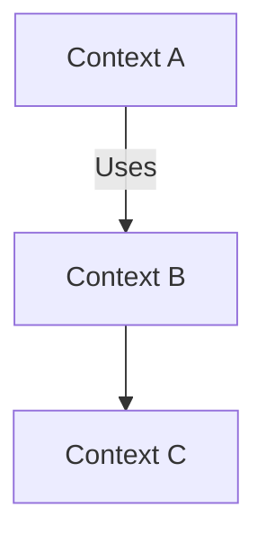

# Plan 52 — Analysis EntrySpec & Templates (v0)

## 1) Problem / Why
We need a deterministic, single‑file **entry point** for any analysis effort, with templates that make the output structure uniform and easy for both humans and LLMs. Today, analysis write‑ups are ad‑hoc; we want a repeatable pattern that scales.

## 2) Goals
- Provide a **single-file EntrySpec (`ENTRY.md`)** pattern that an agent can execute verbatim.
- Ship **universal templates** for the five common report files.
- Add a **Cline workflow prompt** to run an EntrySpec with a two‑line kickoff.
- Seed one **example EntrySpec** (Rules & Workflows) as a ready‑to‑run sample.
- Keep changes **docs‑only** (no code), passing repo hygiene checks.

## 3) Non‑Goals (for this plan)
- No new CLI commands (a generator can come later).
- No JSON Schema validator for EntrySpec (front‑matter only for v0).
- No CI runner for EntrySpec (manual/Cline run is sufficient for v0).

## 4) Deliverables (net new files)
- `docs/analysis/README.md`
- `docs/analysis/_templates/README.md`
- `docs/analysis/_templates/ENTRY.template.md`
- `docs/analysis/_templates/00-methodology.template.md`
- `docs/analysis/_templates/01-inventory.template.md`
- `docs/analysis/_templates/02-systems-and-relations.template.md`
- `docs/analysis/_templates/03-cli-capabilities.template.md`
- `docs/analysis/_templates/04-findings-gaps-recos.template.md`
- `docs/prompts/cline/execute_entry.workflow.md`
- `rules/pack/core/RULE-analysis-entryspec.md`
- Example effort folder:
  - `docs/analysis/2025-09_rules-and-workflows/ENTRY.md` (ready to run)

## 5) Work Items
1. **Create the analysis area & templates** under `docs/analysis/` as specified in *Appendix A*.
2. **Add Cline workflow** prompt (*Appendix B*).
3. **Add rule** documenting that all future analysis efforts should use EntrySpec (*Appendix C*).
4. **Add example EntrySpec** for Rules & Workflows (*Appendix D*).
5. **Run hygiene checks**:
   - `nexoscli dev repo check --fix-readmes --output json`
   - `nexoscli dev doctor --ci --checks repo,plugins,config,tools --output json`
6. **(Optional)** Update `docs/README.md` with a short link to `docs/analysis/README.md`.

## 6) Acceptance Criteria
- All deliverable files exist with the **exact contents** from appendices.
- `nexoscli dev repo check` reports OK (no new violations).
- `nexoscli dev doctor --ci --checks repo,plugins,config,tools` reports OK.
- **Smoke‑test** the sample EntrySpec:
  - Open `docs/analysis/2025-09_rules-and-workflows/ENTRY.md` and run the Cline workflow from *Appendix B*;
  - Verify the five output files are generated/updated under the same folder and include front‑matter, proper parent/child links, and labeled **Confirmed vs Inferred** markings in `03-cli-capabilities.md`.

## 7) Operator Notes (after merge)
**To start a brand new analysis:**
1. `cp -R docs/analysis/_templates docs/analysis/2025-10_<slug>`
2. Rename `ENTRY.template.md` → `ENTRY.md`, fill front‑matter fields and tweak allow‑lists.
3. Run the Cline workflow from *Appendix B* with the new `ENTRY.md` path.

---

## Appendix A — Files to Add/Update (authoritative contents)

> **Cline:** Create these files exactly as shown (preserve front‑matter). Do not alter paths.

### A.1 `docs/analysis/README.md`
```md
---
schema: readme.v0
title: "Analysis/"
summary: "Deterministic, single-file EntrySpecs and report templates for repeatable analyses."
kind: domain
owner: "@docs/dri"
status: live
version: "0.1.0"
last_reviewed: "2025-09-07T00:00:00Z"
parents: ["../README.md","../../README.md"]
children: []
tags: ["analysis","templates","agents"]
auto:
  children_glob: ["*/README.md"]
  dir_tree_depth: 1
---
# Analysis — EntrySpec System

Use **ENTRY.md** to drive a deterministic analysis. Typical outputs:
- `00-methodology.md`
- `01-inventory.md`
- `02-systems-and-relations.md`
- `03-cli-capabilities.md`
- `04-findings-gaps-recos.md`

## How to start a new analysis
1. Copy `_templates` → `./<yyyy-mm>_<slug>/`  
2. Rename `ENTRY.template.md` → `ENTRY.md` and fill front‑matter  
3. Run the Cline workflow: see `docs/prompts/cline/execute_entry.workflow.md`
```

A.2 docs/analysis/_templates/README.md

---
schema: readme.v0
title: "Analysis Templates"
summary: "Reusable EntrySpec and section templates."
kind: folder
owner: "@docs/dri"
status: live
version: "0.1.0"
parents: ["../README.md","../../README.md"]
children: []
tags: ["templates"]
auto:
  children_glob: ["*.md"]
---
# Analysis Templates

Copy this folder to a new effort. Rename `ENTRY.template.md` → `ENTRY.md`, update front‑matter, and run the Cline workflow.

A.3 docs/analysis/_templates/ENTRY.template.md

---
schema: analysis.entry.v0
title: "<Topic> — EntrySpec"
summary: "Single-file, deterministic instructions for an analysis/refactor effort."
owner: "<@dri>"
status: "template"
version: "0.1.0"
created_at: "YYYY-MM-DDTHH:MM:SSZ"
parents: ["../README.md","../../README.md"]
topic_slug: "<yyyy-mm>_<topic-slug>"
inputs:
  include:
    - "../../**/*.md"
    - "../../../rules/**"
    - "../../../examples/workflows/**"
    - "../../../plugins/**"
    - "../../../nexoscli-bin/tests/**/*.rs"
  exclude:
    - "../../../target/**"
    - "../../../**/node_modules/**"
    - "../../../**/.nexoscli/**"
  read_order:
    - "../../RULES.md"
    - "../../WORKFLOWS.md"
    - "../../../rules/**"
    - "../../../examples/workflows/**"
    - "../../prompts/cline/**"
    - "../../../plugins/**"
outputs:
  - path: "./00-methodology.md"
    kind: "md"
  - path: "./01-inventory.md"
    kind: "md"
  - path: "./02-systems-and-relations.md"
    kind: "md"
  - path: "./03-cli-capabilities.md"
    kind: "md"
  - path: "./04-findings-gaps-recos.md"
    kind: "md"
write_allowlist:
  - "./*.md"
acceptance:
  - "All outputs exist and render without broken relative links."
  - "Every file includes correct front-matter + parents/children."
  - "03-cli-capabilities labels Confirmed vs Inferred."
  - "04-findings-gaps-recos has 3–5 prioritized, testable gates."
commit:
  message: "analysis(<topic-slug>): initial pass v0"
  co_authors: []
notes:
  - "Prefer confirmed facts from tests/code; mark inferences."
---

# Agent Protocol (execute verbatim)

1) **Load this EntrySpec.** Treat front‑matter as the authoritative contract.  
2) **Gather context** only from `inputs.include` − `inputs.exclude` in `read_order`.  
3) **Produce outputs** exactly as listed under `outputs`, with these constraints:
   - Each file starts with front‑matter: `schema`, `title`, `owner`, `status`, `version`, `parents`, `children`.
   - Use ≤ 3 heading levels; short paragraphs; prefer bullets and tables.
   - In `03-cli-capabilities.md`, label each statement **Confirmed** (tests/code) or **Inferred** (docs/structure).
4) **Write policy:** Only write paths matching `write_allowlist`. Update idempotently.  
5) **Acceptance check:** Ensure all `acceptance` points pass. If any fail, stop and report which and why.  
6) **Summary output:** At the end, print changed files, notable inferences (to confirm later), and the minimal follow‑ups.  
7) **(Optional) Commit:** Propose `commit.message` for the human to apply.

A.4 Section templates

Cline: Add each file with the exact content below.

A.4.1 docs/analysis/_templates/00-methodology.template.md

---
schema: analysis.section.v0
title: "Methodology"
owner: "<@dri>"
status: "template"
version: "0.1.0"
parents: ["./README.md","../README.md"]
children: []
---
# Methodology

## Scope
- What is in/out for this analysis.

## Deterministic Steps
1. Sources scanned (lists/globs)
2. Ordering / precedence
3. Normalization & labeling (Confirmed vs Inferred)
4. Outputs to be produced (with brief purpose)

## Acceptance Gates
- Clear pass/fail gates for this particular run.

A.4.2 docs/analysis/_templates/01-inventory.template.md

---
schema: analysis.section.v0
title: "Inventory"
owner: "<@dri>"
status: "template"
version: "0.1.0"
parents: ["./README.md","../README.md"]
children: []
---
# Inventory

List all relevant artifacts with one‑line descriptions and why they matter.

| Path | Kind | What it contains | Why it matters |
|------|------|------------------|----------------|
| …    | …    | …                | …              |

A.4.3 docs/analysis/_templates/02-systems-and-relations.template.md

---
schema: analysis.section.v0
title: "Systems & Relations"
owner: "<@dri>"
status: "template"
version: "0.1.0"
parents: ["./README.md","../README.md"]
children: []
---
# Systems & Relations

## Bounded Contexts
- Context A — purpose, owners, SSoT(s)
- Context B — purpose, owners, SSoT(s)

## Relations (Mermaid sketch)

Sources of Truth Matrix

Area	SSoT path(s)	Notes
…	…	…

**A.4.4 `docs/analysis/_templates/03-cli-capabilities.template.md`**
```md
---
schema: analysis.section.v0
title: "CLI Capabilities"
owner: "<@dri>"
status: "template"
version: "0.1.0"
parents: ["./README.md","../README.md"]
children: []
---
# CLI Capabilities

> Label each claim as **Confirmed** (tests/code) or **Inferred** (docs/structure).

## By Plugin
| Plugin | Command | What it does | Evidence | Label |
|--------|---------|--------------|----------|-------|
| dev    | plans verify | Validate plan lifecycle | nexoscli-bin/tests/dev_plans_verify_ok.rs | Confirmed |
| …      | …       | …            | …        | Inferred |

## Gaps / Friction
- …

## Quick Wins
- …
```

A.4.5 docs/analysis/_templates/04-findings-gaps-recos.template.md

---
schema: analysis.section.v0
title: "Findings, Gaps & Recommendations"
owner: "<@dri>"
status: "template"
version: "0.1.0"
parents: ["./README.md","../README.md"]
children: []
---
# Findings, Gaps & Recommendations

## Key Findings (5–8 bullets)
- …

## Gaps (objective)
- …

## Prioritized Recommendations (3–5)
1. **<Action>** — impact, effort, risk  
   *Acceptance gate:* …
2. …

## Follow‑ups / Next Plan Candidates
- …


⸻

Appendix B — Cline workflow prompt

Path: docs/prompts/cline/execute_entry.workflow.md

# Workflow: Execute EntrySpec

## System
You are an execution agent. Read and execute the EntrySpec at the given path **exactly** as written.
- Treat the EntrySpec front‑matter as the authoritative contract.
- Only read from its `inputs.include` minus `inputs.exclude` (in `read_order`).
- Only write to paths matching its `write_allowlist`.
- Produce all listed outputs, with required front‑matter and graph links.
- Perform acceptance checks and report a concise run summary.

## User
EntrySpec path: `<REPLACE_WITH_PATH>`  
Action: Execute now and print a final summary (changed files, any TODOs).


⸻

Appendix C — Rule (normative)

Path: rules/pack/core/RULE-analysis-entryspec.md

# RULE — Use EntrySpec for Analyses

**Intent:** All repo‑level analyses (surveys, audits, redesign proposals) MUST use the EntrySpec pattern:
- Single file: `docs/analysis/<yyyy-mm>_<slug>/ENTRY.md`
- Deterministic front‑matter (`analysis.entry.v0`) and explicit write allow‑list
- Standard outputs: 00..04 section files with front‑matter and parent/child links

**Why:** Reduces entropy, enables reproducible agent runs, keeps outputs uniform and navigable.

**How to comply:**
1. Copy `docs/analysis/_templates` to a new effort folder.
2. Rename `ENTRY.template.md` → `ENTRY.md`, fill fields, adjust inputs/outputs.
3. Use `docs/prompts/cline/execute_entry.workflow.md` to run.

**Scope:** Documentation/analysis tasks only. Code generators or CLI support may be introduced later.


⸻

Appendix D — Example EntrySpec (ready to run)

Path: docs/analysis/2025-09_rules-and-workflows/ENTRY.md

---
schema: analysis.entry.v0
title: "Rules & Workflows — EntrySpec (2025‑09)"
summary: "Deterministic single-file entry to generate/update the R&W analysis set."
owner: "@rules-workflows/dri"
status: "draft"
version: "0.1.0"
created_at: "2025-09-07T00:00:00Z"
parents: ["./README.md","../README.md","../../README.md"]
topic_slug: "2025-09_rules-and-workflows"
inputs:
  include:
    - "../../**/*.md"
    - "../../../rules/**"
    - "../../../examples/workflows/**"
    - "../../../plugins/**"
    - "../../../nexoscli-bin/tests/**/*.rs"
  exclude:
    - "../../../target/**"
    - "../../../**/node_modules/**"
    - "../../../**/.nexoscli/**"
  read_order:
    - "../../RULES.md"
    - "../../WORKFLOWS.md"
    - "../../../rules/**"
    - "../../../examples/workflows/**"
    - "../../prompts/cline/**"
    - "../../../plugins/rules/**"
    - "../../../plugins/workflow/**"
    - "../../ADRs/**"
outputs:
  - path: "./00-methodology.md"
    kind: "md"
  - path: "./01-inventory.md"
    kind: "md"
  - path: "./02-systems-and-relations.md"
    kind: "md"
  - path: "./03-cli-capabilities.md"
    kind: "md"
  - path: "./04-findings-gaps-recos.md"
    kind: "md"
write_allowlist:
  - "./*.md"
acceptance:
  - "All 5 outputs exist and render without broken relative links."
  - "Every file includes correct front-matter + parents/children."
  - "03-cli-capabilities.md clearly labels Confirmed vs Inferred."
  - "04-findings-gaps-recos.md has 3–5 prioritized recommendations with gates."
commit:
  message: "analysis(rules-workflows): v0 deterministic report"
  co_authors: []
notes:
  - "Prefer tests in nexoscli-bin/tests/** to confirm CLI claims."
  - "Do not redefine sources of truth; link to them."
---

# Agent Protocol (execute verbatim)

1) **Load this EntrySpec** and confirm paths are relative to `docs/analysis/2025-09_rules-and-workflows/`.  
2) **Discover inputs** using `inputs.include` − `inputs.exclude`, following `read_order`. Do not read outside this set.  
3) **Generate/refresh outputs** listed under `outputs` using the structures defined in `_templates`:
   - `00-methodology.md` — deterministic method used here (brief).
   - `01-inventory.md` — enumerated list of rules/workflows/prompts/plugins/tests (one‑liners, why they matter).
   - `02-systems-and-relations.md` — bounded contexts + a mermaid diagram + SSoT matrix.
   - `03-cli-capabilities.md` — per‑plugin capability audit with **Confirmed** vs **Inferred**.
   - `04-findings-gaps-recos.md` — concise, prioritized actions with acceptance gates.
4) **Front‑matter & graph:** Ensure each file has front‑matter and correct `parents`/`children` so the README graph is navigable.  
5) **Write policy:** Only write within `write_allowlist`. Update files idempotently.  
6) **Acceptance check:** Verify all acceptance criteria in `acceptance`.  
7) **Summary output:** Print changed files and any TODOs for future confirmation.

(Optional) If you want a README.md inside the example folder, you can copy docs/analysis/_templates/README.md and adjust the title/summary.

⸻

Appendix E — Minimal kickoff prompt (for later use)

When Plan 52 is merged, you can launch any analysis with:

System

You are an execution agent. Read and execute the EntrySpec at the provided path EXACTLY as written. Only write within its write_allowlist. Produce a final summary.

User

Path: docs/analysis/2025-09_rules-and-workflows/ENTRY.md
Execute now.


⸻

How to ask Cline to implement Plan 52

Paste this as your Cline task:

Implement Plan 52.
	1.	Create the plan file at docs/project/next/PLAN-52_analysis-entryspec-and-templates.md (content pasted from my message).
	2.	Apply Appendix A–D verbatim: add all listed files with exact contents.
	3.	Run checks:
	•	nexoscli dev repo check --fix-readmes --output json
	•	nexoscli dev doctor --ci --checks repo,plugins,config,tools --output json
	4.	Report results and any diffs.
	5.	Do not modify code outside docs/rules/prompts.

Once Cline completes this plan, you can immediately create a new folder from _templates, fill ENTRY.md, and run the workflow to generate a full report for any topic.
